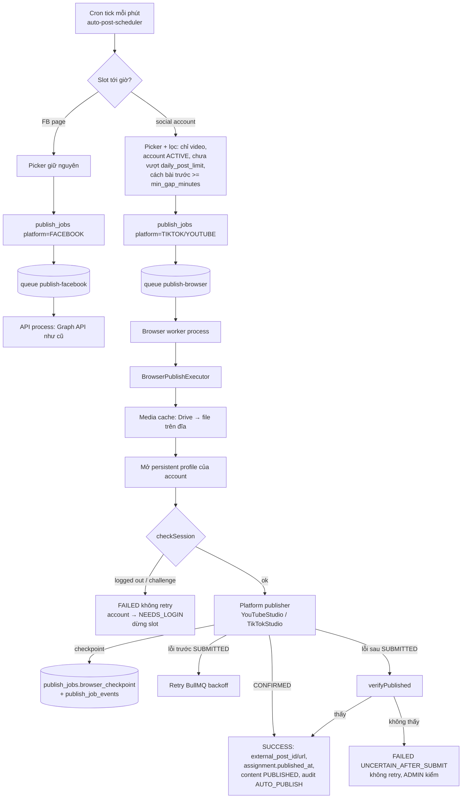

# Plan 34 — Đăng bài TikTok / YouTube bằng trình duyệt tự động (Playwright)

**Milestone:** M13
**Trạng thái:** ⬜ chưa làm — **thiết kế xong, chờ user chốt 5 câu hỏi ở §9**
**Phụ thuộc:** Plan 07 (auto-post engine), Plan 17 (media cache theo đường dẫn đĩa)
**Spec tham chiếu:** `docs/03-database-design.md`, `docs/08-bullmq.md` (chỉ đọc — không sửa)
**Ngày thiết kế:** 2026-10-07

> Mở rộng scope: `contexts.md` §2 đang ghi TikTok **ngoài scope**. Plan này do user yêu
> cầu 2026-10-07 ⇒ khi chốt §9 phải cập nhật §2 + thêm ADR-019 vào `contexts.md`.

---

## 1. Mục tiêu

Ngoài Facebook Page, kho nội dung đăng được **video** lên **TikTok** và **YouTube**
(cả tự động theo mốc giờ lẫn đăng tay), dùng chung kho `content_assets`, chung cơ chế
slot/picker/chống double-fire, chung màn Lịch đăng bài / Queue / Failed Jobs.

- **Facebook giữ nguyên 100%** luồng Graph API hiện tại (queue `publish-facebook`).
- **TikTok + YouTube** đăng bằng **Chromium điều khiển qua Playwright**, mở profile đã
  đăng nhập sẵn (persistent profile), thao tác trên TikTok Studio / YouTube Studio như
  người thật.

## 2. Ngoài phạm vi

- Đăng **ảnh** / carousel lên TikTok, Community post YouTube — chỉ video.
- Lấy số liệu view/like từ TikTok/YouTube (M11 insights chỉ Facebook).
- Đăng nhập tự động bằng username/password, tự giải captcha/2FA — **luôn có người làm**.
- Instagram, Reels FB, Douyin.
- Dùng tính năng **hẹn giờ của nền tảng** cho auto-post (slot của tool đã là bộ hẹn giờ —
  xem QĐ-6).
- Chạy nhiều tài khoản song song trên cùng VPS ở giai đoạn đầu (concurrency = 1).

---

## 3. Phân tích ý tưởng — nói thẳng trước khi code

### 3.1 Vì sao không dùng API chính thức (và khi nào nên quay lại)

| Nền tảng | API chính thức | Rào cản thực tế |
|---|---|---|
| YouTube | Data API v3 `videos.insert` | Project Google **chưa qua audit** ⇒ video upload qua API bị **khoá Private**. Quota upload/ngày thấp, nâng phải xin. |
| TikTok | Content Posting API (Direct Post) | App **chưa audit** ⇒ bài chỉ ở chế độ `SELF_ONLY` (riêng tư). Audit cần app public + chính sách. |

⇒ Browser automation là cách **duy nhất hôm nay** đăng công khai mà không chờ audit.
Đây là lý do hợp lệ, nhưng phải chấp nhận đánh đổi ở §3.2.

**Thiết kế giữ đường lùi:** publisher nằm sau interface `ChannelPublisher` (§5.3). Khi
nào có audit YouTube/TikTok thì thêm driver `api` cho platform đó, **không** đụng picker,
queue, schema. Cột `social_accounts.driver` (`BROWSER | API`) để sẵn.

### 3.2 Rủi ro của hướng browser — xếp theo mức nặng

| # | Rủi ro | Hệ quả | Giảm thiểu (thiết kế bên dưới) |
|---|---|---|---|
| R1 | **Vi phạm ToS / bị khoá tài khoản.** Cả hai nền tảng cấm tự động hoá UI; TikTok phát hiện bot rất gắt | Mất kênh thật | Nhịp đăng giống người (giới hạn/ngày, giãn cách), 1 profile cố định / 1 IP ổn định, không chạy song song cùng tài khoản, **chạy thử trên kênh phụ trước** (§7 Phase 0) |
| R2 | **Đăng trùng** khi retry sau lúc đã bấm "Đăng" | Spam kênh thật | Checkpoint theo bước — qua mốc `SUBMITTED` thì **cấm retry mù**, chỉ chạy *verify* (QĐ-4) |
| R3 | **Selector vỡ** khi Studio đổi giao diện | Job hỏng hàng loạt | Page-object tách riêng từng platform, selector ưu tiên `getByRole`/label; lỗi ⇒ lưu screenshot + trace; health-check hằng ngày phát hiện sớm |
| R4 | **Session hết hạn / bị bắt xác minh** (captcha, 2FA, "đăng nhập đáng ngờ") | Không đăng được, không tự cứu | Account chuyển `NEEDS_LOGIN`, tạm dừng slot của account đó, báo trên UI; đăng nhập lại qua VNC (QĐ-3) |
| R5 | **RAM/CPU**: mỗi Chromium ~300–600MB, upload video lâu | API backend chậm/chết theo | Chạy browser ở **process worker riêng** (QĐ-2), concurrency 1 |
| R6 | **Profile = phiên đăng nhập** (tương đương mật khẩu) | Lộ là mất kênh | Thư mục profile `chmod 700`, ngoài repo, không backup lên chỗ công khai; trace chứa cookie ⇒ chỉ ADMIN tải được |
| R7 | **Headless bị phát hiện** dễ hơn có giao diện | Bị chặn/captcha | Mặc định chạy **headed trên Xvfb** ở VPS; `BROWSER_HEADLESS=true` chỉ là tuỳ chọn |

**Kết luận phân tích:** làm được, nhưng **phải có Phase 0 (spike)** chạy thật trên VPS với
kênh phụ trước khi đụng schema. Nếu spike cho thấy TikTok bắt captcha liên tục từ IP VPS
thì dừng TikTok, chỉ làm YouTube — quyết định này rẻ ở Phase 0, đắt ở Phase 4.

---

## 4. Quyết định kiến trúc đề xuất (chốt ở §9 trước khi code)

### QĐ-1 — Playwright **Node/TypeScript**, nằm trong backend NestJS

Không dựng service Python thứ hai. Dùng gói `playwright` (Chromium), cài trên VPS bằng
`npx playwright install --with-deps chromium`. Lý do: cùng stack, dùng lại thẳng
`PublishMediaService` / media cache (plan 17 đã đưa file về **đường dẫn đĩa** —
`page.setInputFiles(path)` nhận đúng thứ đó, không nạp video vào RAM).

### QĐ-2 — Queue riêng `publish-browser` + **process worker riêng**

```text
API process (hiện tại, PM2 app "tool-auto-fb-api")
  ├── cron scheduler + picker  → tạo publish_jobs → đẩy queue theo platform
  ├── Processor publish-facebook        (giữ nguyên, ADR-002)
  └── KHÔNG load Playwright

Browser worker (MỚI, PM2 app "tool-auto-fb-browser", entry dist/browser-worker.js)
  └── Processor publish-browser  (concurrency = BROWSER_MAX_CONCURRENCY, mặc định 1)
        └── Playwright + Chromium + Xvfb
```

- Cùng codebase, khác bootstrap: `NestFactory.createApplicationContext(BrowserWorkerModule)`
  — không mở HTTP port. Đây chính là bước "tách process sau" mà ADR-002 đã dự liệu.
- Browser crash / ngốn RAM **không** kéo API sập. PM2 `max_memory_restart` cho riêng worker.
- Concurrency 1 ⇒ tự động tuần tự theo account, không cần khoá phân tán ở giai đoạn đầu.
  Khi nâng >1 thì bắt buộc thêm khoá profile theo account (Chromium không cho 2 process
  mở cùng một `userDataDir`).
- Theo tinh thần QĐ-6 của reup: **browser là phụ thuộc tuỳ chọn**. Không cài Chromium /
  không chạy worker ⇒ API vẫn boot, FB vẫn đăng, job TikTok/YouTube nằm QUEUED và
  Queue Monitor báo "worker browser không hoạt động".

### QĐ-3 — Phiên đăng nhập: **persistent profile trên VPS, đăng nhập 1 lần qua VNC-over-SSH**

Mỗi account có 1 thư mục `BROWSER_PROFILES_DIR/<socialAccountId>/` dùng với
`chromium.launchPersistentContext(dir, …)`.

Đăng nhập lần đầu / khi hết phiên (thao tác của ADMIN, ngoài UI web):

```bash
# trên máy admin
ssh -L 5900:127.0.0.1:5900 user@vps
# trên VPS
cd backend && npm run browser:login -- --account <socialAccountId>
#   ⇒ mở Chromium CÓ giao diện trên Xvfb + x11vnc chỉ bind 127.0.0.1
# admin mở VNC client tới localhost:5900, đăng nhập TikTok/Google bằng tay, giải 2FA
# đóng trình duyệt ⇒ script kiểm tra session OK ⇒ account về ACTIVE
```

Vì sao không "đăng nhập trên máy mình rồi xuất cookie lên VPS": Google/TikTok gắn phiên với
IP + fingerprint thiết bị — chuyển cookie sang IP khác rất hay bị bắt xác minh lại. Đăng
nhập **ngay trên chính profile + IP sẽ chạy thật** là cách ít bị thử thách nhất.
(Import `storageState` để làm phương án dự phòng, không làm ở plan này.)

### QĐ-4 — Chống đăng trùng bằng **checkpoint** theo bước, không retry mù

Mỗi lần chạy, publisher báo tiến độ qua `onCheckpoint(step)`; executor ghi
`publish_jobs.browser_checkpoint` + 1 dòng `publish_job_events`.

| Checkpoint | Ý nghĩa | Lỗi xảy ra **trước/tại** mốc này |
|---|---|---|
| `SESSION_OK` | Đã vào Studio, đang đăng nhập | — |
| `FILE_UPLOADED` | File lên xong 100% | retry bình thường |
| `FORM_FILLED` | Đã điền tiêu đề/mô tả/tuỳ chọn | retry bình thường |
| `EXTERNAL_ID_CAPTURED` | (YouTube) đã đọc được video ID trong hộp thoại | retry ⇒ phải **xoá bản nháp** cũ trước hoặc verify |
| `SUBMITTED` | Đã bấm Đăng/Publish | **CẤM retry tự động** ⇒ chạy `verifyPublished()` |
| `CONFIRMED` | Thấy xác nhận đã đăng | ⇒ SUCCESS |

Lỗi sau `SUBMITTED`: gọi `verifyPublished()` (YouTube: mở trang video theo ID đã lấy;
TikTok: tìm trong danh sách bài ở Studio theo caption + thời điểm). Thấy ⇒ SUCCESS.
Không thấy ⇒ `FAILED` với mã `UNCERTAIN_AFTER_SUBMIT`, **không** retry, ADMIN kiểm tay.
Đây là chỗ rule 02 bắt buộc test kỹ (cùng nhóm "chống double-fire").

### QĐ-5 — Phân loại lỗi có mã, quyết định retry theo mã

`BrowserPublishError { code, phase, retryable }`:

| Mã | Retry? | Tác động thêm |
|---|---|---|
| `NAV_TIMEOUT`, `UPLOAD_STALLED`, `NETWORK` | Có (nếu trước `SUBMITTED`) | — |
| `SESSION_EXPIRED` | Không | account ⇒ `NEEDS_LOGIN`, dừng slot của account |
| `CHALLENGE_REQUIRED` (captcha/2FA/xác minh) | Không | như trên |
| `ACCOUNT_RESTRICTED` | Không | account ⇒ `DISABLED`, cảnh báo đỏ |
| `CONTENT_REJECTED` (bản quyền, vi phạm) | Không | — |
| `VALIDATION` (tiêu đề quá dài, file sai định dạng) | Không | — |
| `SELECTOR_NOT_FOUND` | 1 lần | Nghi Studio đổi UI ⇒ cảnh báo |
| `UNCERTAIN_AFTER_SUBMIT` | **Không bao giờ** | Cần người kiểm |

Mọi lỗi: lưu `screenshot.png` + `trace.zip` (Playwright tracing) vào
`BROWSER_ARTIFACTS_DIR/<publishJobId>/<attemptNo>/`, giữ `BROWSER_ARTIFACT_RETENTION_DAYS`
ngày, endpoint tải chỉ ADMIN.

### QĐ-6 — Đăng **ngay** lúc slot tới giờ, không dùng hẹn giờ của nền tảng

Cron slot của tool đã quyết định "lúc nào". Dùng thêm scheduling của YouTube/TikTok sẽ có
2 nguồn sự thật về thời gian và verify khó hơn. Tuỳ chọn hẹn giờ của nền tảng chỉ để mở
rộng sau cho đăng tay.

### QĐ-7 — Schema: bảng mới `social_accounts` + **đích đăng đa hình** trên bảng cũ

Ba hướng đã cân nhắc:

| Hướng | Ưu | Nhược | |
|---|---|---|---|
| A. Đổi `facebook_pages` thành `channels` chung | Sạch nhất về lâu dài | Refactor toàn bộ picker, timeline, dashboard, insights — đụng luồng FB đang chạy | ✗ |
| B. Bộ bảng song song cho TikTok/YT (slot, job, assignment riêng) | Không đụng FB | Nhân đôi picker, chống double-fire, timeline, monitor | ✗ |
| **C. Bảng `social_accounts` + cột đích nullable trên 3 bảng cũ, CHECK đúng-một** | Tái dùng engine; FB giữ nguyên dữ liệu | `facebook_page_id` thành nullable ⇒ phải narrow ở code FB (compiler bắt hết) | **✓ đề xuất** |

Chi tiết ở §5.1.

---

## 5. Thiết kế

### 5.1 Database (đụng schema ⇒ cập nhật `erd.md` cùng thay đổi — rule 05)

**Enum mới**

```text
SocialPlatform       : TIKTOK | YOUTUBE
SocialAccountStatus  : ACTIVE | NEEDS_LOGIN | DISABLED
PublishDriver        : BROWSER | API          -- API để dành, chưa implement
ChannelPlatform      : FACEBOOK | TIKTOK | YOUTUBE   -- cột phân luồng trên publish_jobs
BrowserCheckpoint    : SESSION_OK | FILE_UPLOADED | FORM_FILLED
                       | EXTERNAL_ID_CAPTURED | SUBMITTED | CONFIRMED
```

**Bảng mới `social_accounts`**

| Cột | Kiểu | Ghi chú |
|---|---|---|
| `id` | uuid PK | cũng là tên thư mục profile |
| `platform` | SocialPlatform | |
| `display_name` | text | tên hiển thị trong tool |
| `handle` | text null | `@kenh` / channel handle — điền sau lần login đầu |
| `external_channel_id` | text null | YouTube channel ID / TikTok uid |
| `driver` | PublishDriver | mặc định `BROWSER` |
| `status` | SocialAccountStatus | mặc định `NEEDS_LOGIN` (mới tạo thì chưa có phiên) |
| `is_active` | bool | tạm dừng (giống `facebook_pages.is_active`) |
| `autopost_enabled` | bool | |
| `daily_post_limit` | int | mặc định 3 — chống R1 |
| `min_gap_minutes` | int | mặc định 60 — chống R1 |
| `default_visibility` | text | `public`/`unlisted`/`private` (YT), `everyone`/`friends`/`self` (TT) |
| `options` | jsonb | YT: `madeForKids=false`, `categoryId`… · TT: `allowComment/Duet/Stitch`, `aiGenerated` |
| `last_session_check_at` | timestamptz null | health-check gần nhất |
| `last_session_error` | text null | |
| `deleted_at` | timestamptz null | soft delete giống page |
| `created_by`, `created_at`, `updated_at` | | |

UNIQUE(`platform`, `external_channel_id`) (partial, khi not null) — không thêm 1 kênh 2 lần.

**Sửa 3 bảng cũ** (mỗi bảng thêm `social_account_id uuid null FK`, `facebook_page_id`
chuyển nullable, thêm CHECK `num_nonnulls(facebook_page_id, social_account_id) = 1`):

| Bảng | Thêm | Unique/Index đổi |
|---|---|---|
| `auto_post_slots` | `social_account_id` | index (`social_account_id`, `enabled`) |
| `content_page_assignments` | `social_account_id`, `external_post_id`, `external_url` | giữ UNIQUE(content, page) + **partial** UNIQUE(content, social_account) WHERE social_account_id not null |
| `publish_jobs` | `social_account_id`, `platform` (ChannelPlatform, backfill `FACEBOOK`), `external_post_id`, `external_url`, `browser_checkpoint` | index (`platform`, `status`) |

CHECK constraint và partial unique index Prisma không sinh được ⇒ viết tay SQL trong file
migration (`--create-only` rồi sửa trước khi apply). Ghi rõ trong "Ghi chú ràng buộc" ở
`erd.md`.

`facebook_post_id` cũ **giữ nguyên** cho FB; TikTok/YT dùng `external_post_id`. Không đổi
tên cột cũ ⇒ code FB, insights không phải sửa ngoài việc narrow nullable.

### 5.2 Luồng tổng (end-to-end)



### 5.3 Cấu trúc code backend

```text
backend/src/
├── browser-worker.ts                       # entry process worker (MỚI)
├── browser-worker.module.ts                # chỉ import module cần cho publish-browser
├── infra/browser/                          # (MỚI) hạ tầng Playwright, không biết TikTok/YT
│   ├── browser.module.ts
│   ├── browser-session.service.ts          # launchPersistentContext, timeout, tracing, đóng chắc chắn
│   ├── browser-artifacts.service.ts        # screenshot + trace, dọn theo retention
│   ├── browser.errors.ts                   # BrowserPublishError {code, phase, retryable}
│   └── __tests__/
├── infra/channel-publishers/               # (MỚI) mỗi platform 1 thư mục
│   ├── channel-publisher.interface.ts
│   ├── youtube/
│   │   ├── youtube-studio.publisher.ts     # luồng §5.4
│   │   └── youtube-studio.selectors.ts     # page-object/selector — chỗ duy nhất sửa khi Studio đổi UI
│   └── tiktok/
│       ├── tiktok-studio.publisher.ts      # luồng §5.5
│       └── tiktok-studio.selectors.ts
├── modules/social-accounts/                # (MỚI) CRUD + trạng thái session + health-check
│   ├── social-accounts.{module,controller,service,repository}.ts
│   ├── social-session-health.service.ts    # cron kiểm phiên hằng ngày
│   ├── dto/ · __tests__/
├── modules/publish-jobs/
│   ├── publish-browser.processor.ts        # (MỚI) chỉ đăng ký trong browser worker
│   ├── browser-publish-executor.service.ts # (MỚI) checkpoint + verify + phân loại lỗi
│   ├── publish-queue.constants.ts          # + PUBLISH_BROWSER_QUEUE, chọn queue theo platform
│   └── publish-executor.service.ts         # FB — chỉ narrow facebookPageId, không đổi hành vi
├── modules/auto-post/                       # picker/scheduler nhận đích đa hình
└── scripts/browser-login.ts                 # npm run browser:login (QĐ-3)
```

Interface lõi:

```ts
export interface VideoPostInput {
  file: PublishFileInput;          // tái dùng type của infra/facebook (path trên đĩa)
  title: string;                   // YT: ≤100 ký tự, không '<' '>'
  description: string;             // YT description / TT caption (caption + hashtags)
  visibility: string;
  options: Record<string, unknown>;
}

export interface ChannelPublishResult {
  externalPostId: string | null;   // TikTok có thể null lúc đăng, verify điền sau
  externalUrl: string | null;
}

export interface ChannelPublisher {
  readonly platform: SocialPlatform;
  checkSession(page: Page): Promise<'LOGGED_IN' | 'LOGGED_OUT' | 'CHALLENGE'>;
  publishVideo(
    page: Page,
    input: VideoPostInput,
    onCheckpoint: (step: BrowserCheckpoint, data?: { externalPostId?: string }) => Promise<void>,
  ): Promise<ChannelPublishResult>;
  verifyPublished(page: Page, hint: { externalPostId?: string; description: string; submittedAt: Date })
    : Promise<ChannelPublishResult | null>;
}
```

Executor **không** biết selector; publisher **không** biết DB/BullMQ. Unit test executor
bằng publisher mock (rule 02); publisher test bằng smoke thật (selector không unit test được
có ý nghĩa).

### 5.4 Luồng YouTube Studio (chi tiết hoá flow user đưa)

```text
Publisher job (browser worker)
  ↓
Lấy file video từ media cache (Drive → đĩa, plan 17)
  ↓
launchPersistentContext(profiles/<accountId>)  + tracing.start
  ↓
goto studio.youtube.com
  ↓ bị chuyển sang accounts.google.com?  → SESSION_EXPIRED / CHALLENGE      [SESSION_OK]
Create → Upload videos   (hoặc goto youtube.com/upload)
  ↓
input[type=file].setInputFiles(path)   — không cần mở hộp chọn file của OS
  ↓
Details:  Title (≤100) · Description (≤5000) · Thumbnail (tuỳ chọn, cần kênh đã xác minh SĐT)
          · Audience "No, it's not made for kids" (BẮT BUỘC chọn) · Playlist (tuỳ chọn)  [FORM_FILLED]
  ↓
Đọc link video trong hộp thoại (youtu.be/<id>) → externalPostId        [EXTERNAL_ID_CAPTURED]
  ↓
Next → Video elements → Next → Checks → Next → Visibility (Public/Unlisted/Private)
  ↓
Chờ upload 100% (+ tuỳ chọn chờ Checks bản quyền)                       [FILE_UPLOADED]
  ↓
Bấm Publish/Save                                                        [SUBMITTED]
  ↓
Thấy hộp thoại "Video published" → đóng                                 [CONFIRMED]
```

### 5.5 Luồng TikTok Studio

```text
launchPersistentContext(profiles/<accountId>)
  ↓
goto tiktok.com/tiktokstudio/upload   → bị đá về login? SESSION_EXPIRED   [SESSION_OK]
  ↓
input[type=file].setInputFiles(path)
  ↓
Chờ thanh upload 100% / "Uploaded"                                      [FILE_UPLOADED]
  ↓
Caption (editor contenteditable): xoá tên file TikTok điền sẵn, gõ caption;
  hashtag gõ '#' sẽ bật popup gợi ý ⇒ gõ xong từng tag bấm Space/Escape, không để chọn nhầm
  ↓
Cover (tuỳ chọn) · Who can watch · Allow comment/duet/stitch ·
  Content disclosure · "AI-generated content" (theo options)             [FORM_FILLED]
  ↓
(tuỳ chọn) chờ content check xong
  ↓
Bấm Post → có thể bật modal "Continue to post?" → xác nhận               [SUBMITTED]
  ↓
Chuyển sang trang quản lý bài / toast thành công                         [CONFIRMED]
  ↓
Tìm video vừa đăng trong danh sách (khớp caption + thời gian) → externalPostId/url
  (không tìm ra ngay ⇒ vẫn SUCCESS, external_post_id null, verify bổ sung sau)
```

### 5.6 Frontend

- Màn **"Kênh TikTok / YouTube"** (`/social-accounts`, ADMIN): CRUD account, badge trạng thái
  `ACTIVE/NEEDS_LOGIN/DISABLED`, lần kiểm phiên gần nhất, nút "Kiểm tra phiên", hướng dẫn
  lệnh `browser:login` khi `NEEDS_LOGIN`, cấu hình giới hạn/ngày, giãn cách, visibility,
  options.
- `/auto-post`: bộ lọc/chọn đích gồm cả social account; slot của TikTok/YT **khoá
  `mediaType = video`**.
- `/content` phân bổ: chọn được social account; bài ảnh không gán được vào TikTok/YT.
- `/timeline`, `/queue`, `/failed`: thêm cột/biểu tượng platform; Failed Jobs hiện
  checkpoint cuối + mã lỗi + nút tải screenshot/trace (ADMIN).
- Đăng tay: chọn social account như chọn page.

### 5.7 Env mới (`backend/.env.example` + `.env.production.example` cùng commit — rule 04)

| Biến | Bắt buộc | Mặc định | Ý nghĩa |
|---|---|---|---|
| `BROWSER_PROFILES_DIR` | không | — | Thiếu ⇒ tính năng browser tắt, app vẫn boot |
| `BROWSER_ARTIFACTS_DIR` | không | `<tmp>/browser-artifacts` | screenshot + trace |
| `BROWSER_ARTIFACT_RETENTION_DAYS` | không | 7 | |
| `BROWSER_HEADLESS` | không | `false` | `false` = headed trên Xvfb (khuyến nghị, R7) |
| `BROWSER_MAX_CONCURRENCY` | không | 1 | >1 bắt buộc có khoá profile |
| `BROWSER_NAV_TIMEOUT_MS` | không | 60000 | |
| `BROWSER_UPLOAD_TIMEOUT_MS` | không | 1800000 | video 300MB qua Studio chậm |

Validate trong `src/config/env.validation.ts`, đọc qua `browser.config.ts` — không gọi
`process.env` trong service.

### 5.8 Hạ tầng VPS

```bash
npx playwright install --with-deps chromium
apt install xvfb x11vnc           # headed trên màn hình ảo + VNC cho bước login
# PM2: thêm app thứ 2
#   name: tool-auto-fb-browser
#   script: dist/browser-worker.js
#   interpreter_args / env: DISPLAY=:99 (xvfb-run hoặc service Xvfb riêng)
#   max_memory_restart: 1500M
```

Ghi vào `DEPLOY-VPS-NO-DOCKER.md` một mục riêng khi tới Phase 2. Kiểm RAM VPS trước:
tối thiểu thêm ~1GB rảnh cho 1 Chromium + upload.

---

## 6. Bảo mật

- Thư mục profile + artifacts: `chmod 700`, owner = user chạy PM2, ngoài thư mục repo,
  thêm vào `.gitignore` nếu nằm gần repo.
- Không log cookie/URL có token; trace chỉ tải qua endpoint ADMIN, không serve tĩnh.
- x11vnc **chỉ bind 127.0.0.1**, truy cập bằng SSH tunnel, tắt sau khi đăng nhập xong.
- Không lưu mật khẩu TikTok/Google trong tool — đăng nhập luôn do người làm.

---

## 7. Lộ trình — chia phase, mỗi phase giao được 1 thứ quan sát được

| Phase | Nội dung | Giao được | Gate để sang phase sau |
|---|---|---|---|
| **0. Spike** | Script Playwright độc lập (`backend/scripts/spike/`), không đụng DB: đăng 1 video lên **kênh YouTube phụ** + **TikTok phụ** từ VPS; đo RAM, thời gian, có bị captcha không, headless vs Xvfb | Bằng chứng chạy được trên hạ tầng thật | User xem kết quả, chốt làm cả 2 hay chỉ YouTube |
| **1. Schema + Accounts** | Migration §5.1 + `erd.md` + module `social-accounts` CRUD + màn FE | Quản lý được account | FB hồi quy xanh (toàn bộ test cũ) |
| **2. Browser infra** | Worker process, `BrowserSessionService`, artifacts, `browser:login`, health-check | Đăng nhập + "Kiểm tra phiên" chạy thật | Phiên giữ được qua restart worker |
| **3. YouTube publisher** | §5.4 + executor checkpoint/verify + đăng tay | Đăng tay 1 video YT từ UI | Retry sau SUBMITTED không tạo video thứ 2 |
| **4. TikTok publisher** | §5.5 | Đăng tay 1 video TT từ UI | như trên |
| **5. Auto-post** | Picker đa hình, daily limit/min gap, timeline/queue/failed | Bot tự đăng theo slot | Chạy 3 ngày liên tục không bị khoá kênh |

## 8. Task

### Phase 0 — Spike
- [ ] Cài `playwright` (devDependency trong spike), script đăng YouTube kênh phụ
- [ ] Script đăng TikTok kênh phụ
- [ ] Chạy trên VPS: headless vs Xvfb, ghi RAM đỉnh, thời gian, captcha — ghi kết quả vào §10 file này

### Phase 1 — Schema + Social accounts
- [ ] `schema.prisma`: enum + `SocialAccount` + cột mới 3 bảng
- [ ] **`erd.md`**: bảng, enum, index, ghi chú CHECK đúng-một + partial unique, lịch sử thay đổi
- [ ] Migration `--create-only`, viết tay CHECK + partial unique, rồi apply
- [ ] Narrow `facebookPageId` nullable ở code FB (picker, executor, timeline, insights…)
- [ ] Module `social-accounts` (CRUD, RBAC chỉ ADMIN/SUPER_ADMIN) + Swagger
- [ ] FE `/social-accounts`
- [ ] Toàn bộ test cũ xanh (hồi quy FB)

### Phase 2 — Browser infra
- [ ] `browser.config.ts` + validate env + `.env.example` / `.env.production.example`
- [ ] `browser-worker.ts` + `BrowserWorkerModule`; queue `publish-browser`
- [ ] `BrowserSessionService` (persistent context, tracing, đóng chắc chắn trong `finally`)
- [ ] `BrowserArtifactsService` + cron dọn theo retention
- [ ] `scripts/browser-login.ts` + `npm run browser:login`
- [ ] `SocialSessionHealthService` cron hằng ngày + endpoint "Kiểm tra phiên"
- [ ] PM2 config + mục deploy trong `DEPLOY-VPS-NO-DOCKER.md`

### Phase 3 — YouTube
- [ ] `youtube-studio.selectors.ts` + `youtube-studio.publisher.ts`
- [ ] `BrowserPublishExecutorService` (checkpoint, phân loại lỗi, verify)
- [ ] Đăng tay chọn social account
- [ ] **Unit test bắt buộc** (cùng nhóm auto-post/double-fire, rule 02): lỗi trước SUBMITTED ⇒ retry · lỗi sau SUBMITTED ⇒ verify, **không** retry · verify thấy ⇒ SUCCESS · verify không thấy ⇒ FAILED `UNCERTAIN_AFTER_SUBMIT` · SESSION_EXPIRED ⇒ account NEEDS_LOGIN + không retry · job không QUEUED ⇒ skip (idempotent)

### Phase 4 — TikTok
- [ ] `tiktok-studio.selectors.ts` + `tiktok-studio.publisher.ts` (xử lý popup hashtag, modal xác nhận)
- [ ] Tra externalPostId sau đăng (verify bổ sung)

### Phase 5 — Auto-post
- [ ] Scheduler/picker nhận slot của social account; lọc video-only
- [ ] Chặn theo `daily_post_limit` + `min_gap_minutes` — **unit test bắt buộc**
- [ ] Chống double-fire dùng lại `slot_runs` — test tick 2 lần cùng slot
- [ ] Route job vào đúng queue theo platform — test
- [ ] FE `/auto-post`, `/content`, `/timeline`, `/queue`, `/failed` hiện platform
- [ ] `npm run lint && npm run build` 2 phía xanh, `npm run test` xanh
- [ ] Cập nhật `contexts.md` (§2 scope, ADR-019, §4 M13, §5, §6)

## 9. Câu hỏi cần user chốt trước Phase 1

1. **Chấp nhận rủi ro khoá tài khoản (R1)?** Có kênh phụ để chạy Phase 0 không?
2. **Schema hướng C** (bảng `social_accounts` + cột đích nullable trên 3 bảng cũ) — đồng ý,
   hay muốn đầu tư hướng A (gộp thành `channels` chung) ngay từ giờ?
3. **Đăng nhập qua VNC-over-SSH trên VPS** (QĐ-3) — admin có quyền SSH vào VPS không?
4. **Worker browser process riêng** (QĐ-2) — VPS hiện còn bao nhiêu RAM rảnh?
5. Một content đăng **cùng lúc lên nhiều nền tảng** (FB + TikTok + YT) theo phân bổ — đúng ý?
   (Thiết kế hiện tại cho phép, mỗi đích một assignment/job riêng.)

## 10. Điều kiện nghiệm thu

- [ ] Gỡ Chromium / tắt browser worker ⇒ API boot bình thường, FB vẫn đăng, job TT/YT nằm QUEUED, Queue Monitor báo worker không hoạt động
- [ ] Đăng tay 1 video lên YouTube kênh thật ⇒ job SUCCESS, có `external_url` mở được
- [ ] Đăng tay 1 video lên TikTok ⇒ job SUCCESS
- [ ] Giết worker giữa lúc vừa bấm Publish ⇒ khởi động lại **không** tạo video thứ 2
- [ ] Đăng xuất tài khoản trên trình duyệt ⇒ job kế tiếp FAILED `SESSION_EXPIRED`, account `NEEDS_LOGIN`, slot account đó ngừng tạo job, UI hiện hướng dẫn login lại
- [ ] Slot TT/YT không bao giờ nhặt bài ảnh; vượt `daily_post_limit` ⇒ skip có lý do
- [ ] Lỗi bất kỳ ⇒ tải được screenshot + trace ở `/failed` (ADMIN), EDITOR/CONTENT không tải được
- [ ] Hồi quy FB: toàn bộ test cũ xanh, đăng FB thật vẫn chạy

## 11. Rủi ro còn lại

| Rủi ro | Cách xử lý |
|--------|-----------|
| Studio đổi UI giữa chừng | Selector gom 1 file/platform; health-check hằng ngày mở trang upload kiểm selector chính; trace để sửa nhanh |
| TikTok bắt captcha liên tục từ IP VPS | Phase 0 phát hiện sớm; phương án: proxy dân cư riêng cho account (thêm cột `proxy_enc` sau), hoặc bỏ TikTok giữ YouTube |
| Upload video lớn qua Studio quá chậm | `BROWSER_UPLOAD_TIMEOUT_MS` riêng; concurrency 1 ⇒ không tranh băng thông |
| Job TT/YT dài chặn nhau | Chấp nhận ở giai đoạn đầu (vài bài/ngày); nâng concurrency khi có khoá profile |

---

## 12. Kết quả (điền khi xong)

- **Ngày xong:**
- **File chính:**
- **Khác thiết kế ban đầu:**
- **Test:**
- **Còn nợ:**
